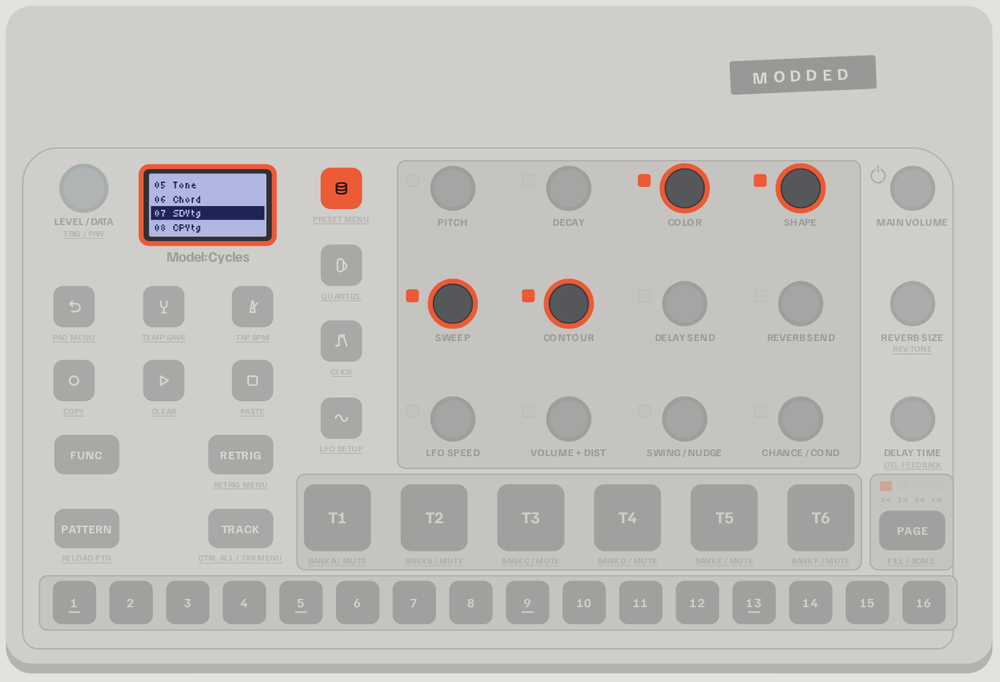
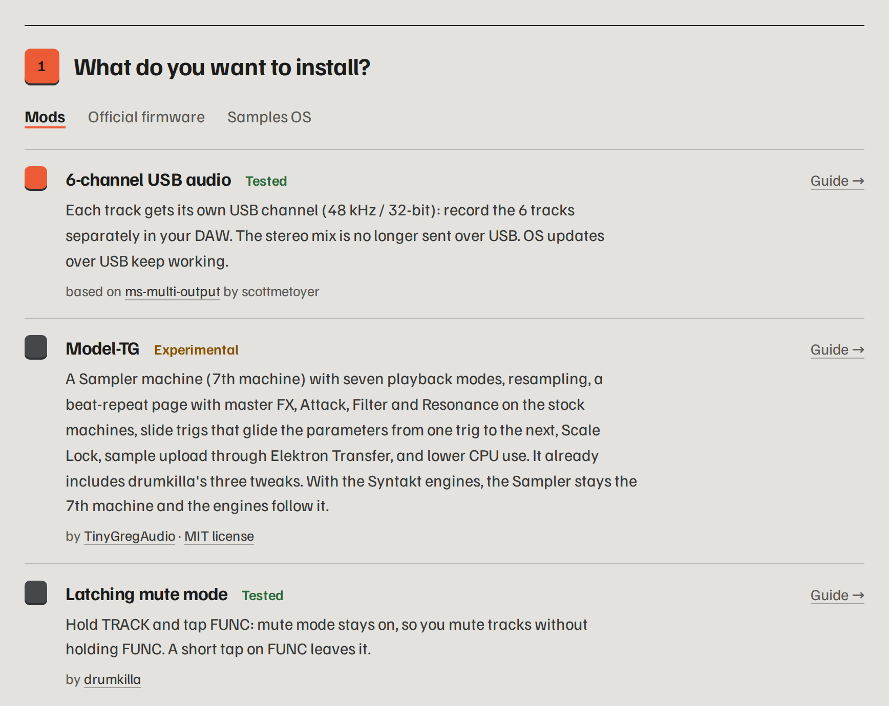

<div align="center">

# Modded Cycles

**Custom firmware mods for the Elektron Model:Cycles, installed from your browser in about 30 seconds.**

6-channel USB audio · Syntakt engines · Sample Wizard · ACID and MACRO machines · ChordKeys · extra LFOs · sequence generator · arpeggiator · up to 546 BPM · and more

[**Open the web flasher**](https://aveycole.github.io/Modded-Cycles/flasher/) &nbsp;·&nbsp;
[Read the guide](https://aveycole.github.io/Modded-Cycles/guide/) &nbsp;·&nbsp;
[Website](https://aveycole.github.io/Modded-Cycles/) &nbsp;·&nbsp;
[Join the Discord](https://discord.gg/hWegtJZcmm) &nbsp;·&nbsp;
[Support on Ko-fi](https://ko-fi.com/18nelli)


</div>

---

## Why

The Model:Cycles is a great little groovebox, but its firmware leaves some obvious things on the table:
the USB output only carries the stereo mix, there are just six machines, the tempo stops at 300 BPM,
and a few everyday gestures (muting, removing trigs) take more presses than they should.

Modded Cycles patches **your own copy** of the official OS to fix that. You pick the mods you want,
the page builds the firmware in your browser, and sends it to the Model:Cycles over USB.
Going back to the official firmware is one click away.

> [!IMPORTANT]
> **No Elektron firmware is included in this repository**, original or modified. You bring the official OS
> file from [elektron.se](https://www.elektron.se/support-downloads/modelcycles); the mods are applied to it on your computer.
> This is an independent project, not affiliated with or endorsed by Elektron. Flashing a modified OS is
> **at your own risk** and may void your warranty.

## The mods

| Mod | What you get | Status |
|---|---|---|
| Silent track selection | Optional, hardware tested: plain track pad selects silently; TRACK + pad selects and plays. Preset preview preserved; unchecked by default. | Tested on hardware |
| **6-channel USB audio** | Each track gets its own USB channel (48 kHz / 32-bit): record six separate stems in your DAW. OS updates over USB keep working. | ✅ Tested |
| **Syntakt engines** | Up to five real Syntakt machines added next to the original six: **SD VINTAGE**, **CP VINTAGE**, **SY TOY**, **SY BITS** and **SY SWARM**, with the Syntakt's knob names and defaults. They are read from your own Syntakt OS file. | ✅ Tested |
| **Sample Wizard** | Adds Wizard as machine 7: sample playback modes, a sample browser and Slice varispeed (notes choose the slice, `PITCH` changes its speed). Upload your own samples with Elektron Transfer in SMP mode, and go back to CYC before a firmware upgrade. By TinyGregAudio, roterodamus and A.V. | ✅ Tested |
| **Sample preview** | An add-on to Sample Wizard: in its sample browser (`FUNC` + `MACHINES`), the track's pad plays the sample under the cursor, the way presets can be heard before you pick them. A sample not yet in memory loads on the first press; if there isn't enough free memory, the press plays nothing. The track keeps its own sample. Requires Sample Wizard (ticking it ticks Sample Wizard) and can't be combined with ChordKeys. | ✅ Tested |
| **MACRO machine** | One extra machine with the 47 synthesis models of Braids, Émilie Gillet's open-source macro-oscillator, from [her own code](https://github.com/pichenettes/eurorack): analog-style waves, FM, vowels, physical models, drums, wavetables and noises. `SHAPE` picks the model, `COLOR` and `SWEEP` shape it, `CONTOUR` lets the amp envelope open the timbre, and `FUNC` + `PITCH` gives lo-fi (`RATE`/`BITS`). Works with Sample Wizard and with the Syntakt engines; the combined option puts MACRO after the selected engines. | ✅ Tested |
| **RETROSYN machine** | Six retro oscillator types with pitch sweep, arpeggios and four-bit punch. Combine RETROSYN with any selection of the added machines, including WAVE and TINY, with independent Sample Wizard optional. ChordKeys is compatible. Expanded machine combinations are verified in emulation. Model-TG is excluded from the main flasher. | ✅ Hardware tested by AveyCole (2026-10-16) |
| **ACID machine** | One extra machine: a TB-303-style acid bass from the open-source Open303 model by Robin Schmidt. `COLOR` is the cutoff, `SHAPE` the resonance, `SWEEP` the env mod, `CONTOUR` the drive. A trig longer than the next one slides into it. Includes Kevin Shallvari's retrigger click fix. | ✅ Tested |
| **ChordKeys** | On a CHORD track, TRIG 1–16 play the chords of your scale (I–VII, then higher octaves). `FUNC` + `RETRIG` sets key, root, scale and triad/7/9/11/13, saved with the pattern. By Nico Heuser. | ✅ Tested |
| **Per-track filter** | Hold `MACHINES` and turn `SWEEP` for cutoff or `CONTOUR` for resonance: a four-pole low-pass on synth and drum tracks (Wizard tracks keep their own filter). Works with p-locks, LFO and CC 74/71, and is saved with the sound. Replaces the older LP/OFF/HP filter. | ✅ Tested |
| **LFO 2, 3, 4** | Press `LFO` again on the LFO page to reach three extra LFOs per track. LFO 2 is saved with the sound and can be p-locked; 3 and 4 are for live play. Based on DavidCaruso's work. | ✅ Tested |
| **Second LFO** | LFO 2 gets its own `LFO SPEED` knob and quick assign (hold `LFO` and turn a knob), and is saved with the sound. Can't be combined with LFO 2, 3, 4. Hardware tested by AveyCole (12–13 October 2026). | ✅ Tested |
| **LFO destination quick assign** | ATK / FLT / RES in both audio LFOs with their modules installed. Hold LFO + MACHINES and turn DECAY / SWEEP / CONTOUR; further turns adjust depth. Wizard keeps its native filter targets and stable labels. Both menus stay open after assignment; machine selection stays closed. | ✅ Hardware tested by AveyCole (2026-10-18) |
| **Sequence Generator** | `SETTINGS` + `PAGE` opens Sequence Genie: scale, root, note range, velocity/decay/pan ranges, rhythm/notes regeneration, mutation and Euclidean rhythm. `PLAY` previews it, and Undo works with playback stopped. During playback, Generate queues the sequence for the track's next loop (or page). Works on stock tracks and Sample Wizard tracks. Hardware tested by AveyCole (10–11 October 2026). | ✅ Tested |
| **SCRAMBLE** | Hold `SETTINGS` + `TRACK` to randomize the checked parameters once. Tap the combo for Mod Setup. Hold trigs first to lock a fresh scramble to those steps. No sound Undo. Hardware tested by AveyCole (11 October 2026). | ✅ Tested |
| **Arpeggiator** | Hold several notes with RETRIG and they play as an arpeggio. `FUNC` + `RETRIG` adds direction (up, down, up/down, random, or in the order played) and range (1 to 4 octaves), saved with the pattern. | ✅ Tested |
| **Tempo up to 546 BPM** | The TEMPO knob, tap tempo, MIDI clock and saved projects go past 300 BPM. Tempo-synced LFOs stay in time. | ✅ Tested |
| **MIDI OUT during THRU** | With `THR` selected, forward incoming MIDI and also send the Cycles' MIDI clock and track/parameter messages. | ✅ Tested |
| **Live MIDI OUT + THRU toggle** | With `THR` selected, hold `FUNC` and press the `LEVEL/DATA` knob to switch the Cycles' own MIDI output on or off while incoming MIDI keeps passing through. The stock `OUT`/`THR` menu stays unchanged. | ✅ Tested |
| **Startup animation** | When the Model:Cycles starts, the four squares of the modded-cycles logo pop in and “modded-cycles” types itself underneath, instead of the original tile animation. Same duration. | ✅ Tested |
| **Volume and pan readout** | On the main screen, turn `LEVEL/DATA` to show the selected track volume (0–127); hold `FUNC` and turn it to show pan (−64 to 63). Values fade after three seconds; the knob changes values one step at a time. | ✅ Tested |
| **Dimmed trigless trigs** | Trigless step keys glow at about one third brightness and keep their normal blink, making them easier to distinguish from note trigs. | ✅ Tested |
| **Multi-line browser** | Show three sound, folder or sample presets at once in the small font. `>` marks the cursor, the loaded sound stays highlighted, and folders get a marker. Compatible with scrolling names and Sample Wizard. From 18nelli18's flasher, based on a community member's idea. | ✅ Tested |
| **Easier trig removal** | A quick press on a step that holds a trig removes it, instead of opening it as a hold. | ✅ Tested |
| **Latching mute** | Hold `TRACK` and tap `FUNC`: mute mode stays on, no more holding `FUNC`. By [drumkilla](https://github.com/drumkilla/elektron-model-tweaks). | ✅ Tested |
| **Trig preview** | Sequencer stopped or paused: hold a step and press `PAGE` to hear it, with its note, length and p-locks. By drumkilla. | ✅ Tested |
| **Scrolling names** | Sound names too long for the screen scroll in the sound browser. By drumkilla. | ✅ Tested |
| **Samples OS** | Turns the Model:Cycles into a Model:Samples, built from both official OS files. Coming back needs a MIDI interface. | ✅ Tested |
| **Cycles OS for Model:Samples** | The other way round: turns a Model:Samples into a Model:Cycles, over USB, from both official OS files. Going back to the Model:Samples OS works over USB too, from the same tab. | 🧪 Experimental |

The mods can be combined except where stated (the two MIDI mods are alternatives; LFO 2, 3, 4 can't be combined with Second LFO, Per-track filter or Sequence Generator; Sample preview excludes ChordKeys; Samples OS and Cycles OS for Model:Samples are separate installs). Each one is explained step by step, with the buttons to press, in the
**[guide](https://aveycole.github.io/Modded-Cycles/guide/)**.

<p align="center">
  <br>
  <sub>The Syntakt engines show up as extra machines in the MACHINES menu.</sub>
</p>

## Install in four steps



1. **Open the [web flasher](https://aveycole.github.io/Modded-Cycles/flasher/)** in Chrome, Edge or Opera on a desktop computer (it needs Web MIDI).
2. **Tick the mods you want.**
3. **Drop your official OS file**, `model-cycles_OS1.13.syx`, from the [Elektron download](https://www.elektron.se/support-downloads/modelcycles) (unzip it first).
   For the Syntakt engines, also drop `Syntakt_OS1.42.syx` ([download](https://www.elektron.se/support-downloads/syntakt); 1.41 works too).
4. **Connect the Model:Cycles over USB and press Flash.** Close Elektron Transfer first and leave the machine on its usual screen.
   The transfer takes about 30 seconds, then the Model:Cycles asks you to confirm with **YES**.

Everything runs in your browser: your files are never uploaded anywhere.

**Before you flash**, back up your projects and samples with Elektron Transfer.

<details>
<summary><b>Other ways to flash</b></summary>

- **Classic method.** If the fast method does not work on your setup, the flasher can also send the firmware the
  way Elektron Transfer does through `CONFIG › UPGRADE` (5 to 10 minutes).
- **Elektron Transfer.** The flasher has a *Download the .syx* button: drop that file onto Elektron Transfer yourself.
- **Command line.** See [Command line](#command-line) below.

</details>

<details>
<summary><b>Going back to the official firmware</b></summary>

Open the flasher, choose the **Official firmware** tab, drop your official OS file and flash. Before that,
set any track that uses an added machine (Syntakt engine, MACRO or Sampler) back to one of the six original machines.

</details>

<details>
<summary><b>If something goes wrong</b></summary>

If a Model:Cycles ever stops starting, it can always be recovered from its startup menu (`FUNC` + power on, then `TRIG 4`).
That menu only listens to the **MIDI IN** port, so you need a USB-MIDI interface and the scripts described in
[`FLASH.md`](FLASH.md) (in French). The guide has a [troubleshooting section](https://aveycole.github.io/Modded-Cycles/guide/#trouble).

</details>

## Command line

The web flasher is a port of a pure-Python toolchain that lives in this repository: no compiler and no firmware needed.

```sh
python3 tools/build.py --list                       # every available mod
python3 tools/build.py -i model-cycles_OS1.13.syx -t 6ch-usbup,latching-mute,trig-preview,browser-scroll
./flash.sh                                           # macOS / Linux  (flash.bat on Windows)
```

Details in [`BUILD.md`](BUILD.md) and [`FLASH.md`](FLASH.md) (both in French). The web flasher is checked byte for byte
against the Python build (`tools/webflash_check.sh`, `tools/webbuild_check.sh`).

## How it is made

Every mod is checked in an emulator that runs the Model:Cycles' own code, and then on a real Model:Cycles before it is
marked *Tested*. The Syntakt engines are not imitations: their code and tables are taken from your Syntakt OS file and
relocated into the Model:Cycles firmware, and they produce the same samples as the Syntakt in emulation.

The research behind it (firmware analysis, hardware architecture, engine ports, measurements) is written up in the
[technical notes](notes/README.md), in French. Release notes for each flasher version are on the
[website](https://aveycole.github.io/Modded-Cycles/#version).

## Credits

This project stands on the work of others, all MIT licensed:

- **[scottmetoyer/ms-multi-output](https://github.com/scottmetoyer/ms-multi-output)**: the original 6-channel USB mod.
- **[drumkilla/elektron-model-tweaks](https://github.com/drumkilla/elektron-model-tweaks)**: latching mute, trig preview, scrolling names, and the `mtlib` toolkit and tweak format used by the build.
- **[TinyGregAudio/Model-TG](https://github.com/TinyGregAudio/Model-TG)**: the base behind Sample Wizard, with roterodamus and A.V. ([license](tweaks/model-cycles_OS1.13/LICENSE-Model-TG)).
- **[pichenettes/eurorack](https://github.com/pichenettes/eurorack)**: Émilie Gillet's Braids code, compiled as is for the synthesis models of the MACRO machine ([license](tweaks/model-cycles_OS1.13/LICENSE-Braids)).
- **Open303** by Robin Schmidt: the TB-303 model behind the ACID machine, with Kevin Shallvari's retrigger click fix.
- **Nico Heuser**: ChordKeys.
- **DavidCaruso**: the LFO work behind LFO 2, 3, 4 and Second LFO.
- **djd_oz**: the volume/pan readout and dimmed trigless trigs.
- **[dagargo/elektroid](https://github.com/dagargo/elektroid)**: the Elektron Transfer update protocol behind fast USB flashing.
- **[mischa85/elektron-firmware-tool](https://github.com/mischa85/elektron-firmware-tool)** and **[mxldyn/octamax](https://github.com/mxldyn/octamax)**: firmware tooling and reverse-engineering methods.

If these mods are useful to you, you can support the project on **[Ko-fi](https://ko-fi.com/18nelli)**.
Questions, feedback and feature requests are welcome on the **[Discord](https://discord.gg/hWegtJZcmm)**; bug reports also fit in the [issues](https://github.com/18nelli18/Modded-Cycles/issues).

MIDI OUT Bank is hardware tested by AveyCole (16 October 2026) and available in the main flasher, alone or alongside the current machines including RETROSYN and TINY. Sample Wizard is optional. MIDI saving is hardware tested, including saving into an empty project slot. Stop playback before Save Project and wait for MIDI SAVED. **Saved MIDI data loads only when you enter B-side and only while playback is stopped.** Model-TG remains blocked.

The hardware-tested saving build is now in main. Extra MIDI files remain outside standard Elektron project backups and SysEx exports. Unsaved edits are lost on power-off. See [note 98](notes/98-persistance-midi-actuelle.md).

[Control All Beat Repeat](https://aveycole.github.io/Modded-Cycles/flasher/) is an independent checklist card, hardware tested by AveyCole. Hold **TRACK + RETRIG**, then hold a TRIG key to repeat the audio tracks included in Control All Config at that division (all six if Control All Config is absent). While both modifiers are held, all sixteen TRIGs select repeat divisions and the normal Control All options are hidden. Releasing either modifier stops it. No dedicated page or master FX; no Model-TG dependency. Install alone or alongside your machines. See [note 99](notes/99-beat-repeat-collectif.md).

Main 1.78 uses the filter and beat-repeat workload repairs confirmed on hardware by AveyCole, including multiple Syn Swarms. Same firmware code as filter-load test 4; MIDI OUT Bank remains optional and experimental.

Swarm LITE replaces the original seven-oscillator Swarm in the main flasher: fundamental plus two detuned saws, lower processing load, and a leaner, potentially quieter sound. AveyCole reports significantly reduced load and clicks on hardware (16 October 2026); heavy arrangements may still click.


Main 2.37 serves the user-tested v115: WAVE includes the AV-WAVE-Morph starter table, custom tables still override it, and BACK goes up folders before closing at /Wavetables. [Controls and printable guide](docs/flasher/shortcut-guide.html).


Main 2.38 serves the user-tested v121: selected FX types and added settings belong to each pattern. Blank patterns start with standard Delay/Reverb; queued switches apply when the pattern starts. Save the project to preserve these settings after reloading. WAVE output gains 6 dB. [Current controls and printable guide](docs/flasher/shortcut-guide.html). [WAV/DX7 importers and resource links](docs/flasher/convert.html).


Main 2.44 serves the exact regular v141 approved by AveyCole. Includes PUNCH FM percussion, PUNCH-controlled Shadow distortion, Mod Setup parameter previews, and MIDI return parameter preservation. S.Chn adds Rev. and Del. stereo effect-return targets alongside its five other track targets, saved per source and pattern. MACHINES closes Mod Setup, including Scramble and S.Chn, so machine selection responds immediately. In S.Chn, Mute On follows source mute/solo, while Off keeps muted sources ducking. This choice saves per source and pattern. Tap SETTINGS + TRACK for Mod Setup; hold to Scramble once. Elder is back to its original level and Shadow gains 12 dB over its original level. Mod Setup > S.Chn adds note-triggered volume ducking with per-source target checkboxes and Depth/Attack/Hold/Release. Sidechain and Scramble checklists save per pattern with Save Project. Blank patterns start with Sidechain off and default Scramble selections. DUCK remains a separate delay type. [Controls and printable guide](docs/flasher/shortcut-guide.html).
