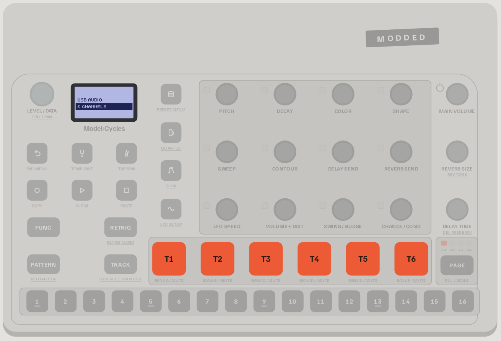

<div align="center">

# Modded Cycles

**One community OS for the Elektron Model:Cycles, installed from your browser in about 30 seconds.**

A Sampler machine · the Syntakt engines · MACRO and ACID machines · four LFOs per track · an arpeggiator · up to 546 BPM · and more

[**Open the web flasher**](https://18nelli18.github.io/Modded-Cycles/flasher/) &nbsp;·&nbsp;
[Read the guide](https://18nelli18.github.io/Modded-Cycles/guide/) &nbsp;·&nbsp;
[Every feature in detail](FEATURES.md) &nbsp;·&nbsp;
[Join the Discord](https://discord.gg/hWegtJZcmm) &nbsp;·&nbsp;
[Support on Ko-fi](https://ko-fi.com/18nelli)



</div>

---

## What it is

Modded Cycles is a free, open-source firmware for the Model:Cycles (OS 1.13). It keeps Elektron's workflow and
extends it: more machines, more modulation, better everyday gestures. It is not a rewrite of the OS, and it is not a
mod store: what goes in is chosen for its value, its stability and how well it fits the rest.

Since version 2.0 there is **a single OS**, the Modded Cycles OS, instead of a list of mods to tick. Everyone runs
the same firmware, so projects, tips and bug reports mean the same thing for everyone.

The flasher builds the firmware **in your browser**, from **your own copies** of the official Elektron files, and
sends it to the machine over USB. Going back to the official firmware is one click away.

> [!IMPORTANT]
> **No Elektron firmware is included in this repository**, original or modified. You bring the official OS files
> from [elektron.se](https://www.elektron.se/support-downloads/modelcycles); the OS is built from them on your
> computer. This is an independent project, not affiliated with or endorsed by Elektron. Flashing a modified OS is
> **at your own risk** and may void your warranty.

## What's in the OS

| Feature | What you get | Origin | Status |
|---|---|---|---|
| **Sampler machine** | Model-TG's Sampler as the 7th machine: samples from the internal storage with seven playback modes (one shot, loop, slice, granular, stretch, pluck, wave), slicing, resampling, a retrig page with 12 master effects, Attack, Filter and Resonance on the original machines, slide trigs, Scale Lock, sample upload through Elektron Transfer, a System page. | [TinyGregAudio/Model-TG](https://github.com/TinyGregAudio/Model-TG) 1.1.0, MIT | 🧪 Experimental |
| **Syntakt engines** | Five real Syntakt machines, **SD VINTAGE**, **CP VINTAGE**, **SY TOY**, **SY BITS** and **SY SWARM**, as machines 8 to 12, with the Syntakt's knob names and defaults. Their code is read from your own Syntakt OS file. | Elektron's code, from your file | ✅ Tested |
| **MACRO machine** | Machine 13: the 47 synthesis models of Braids, Émilie Gillet's macro-oscillator. `SHAPE` picks the model, `FUNC` + `PITCH` gives lo-fi. | [pichenettes/eurorack](https://github.com/pichenettes/eurorack), MIT | ✅ Tested |
| **ACID machine** | Machine 14: an acid bass in the style of the TB-303, with cutoff, resonance, env mod, drive, saw or square, and slides from your trigs. | [RobinSchmidt/Open303](https://github.com/RobinSchmidt/Open303), MIT | ✅ Tested |
| **LFO 2, 3, 4** | Three more LFOs per track: on the LFO page, press `LFO` again. LFO 2 is saved with the sound and can be p-locked. | After DavidCaruso | ✅ Tested |
| **Arpeggiator** | Hold several notes with `RETRIG` and they arpeggiate; `FUNC` + `RETRIG` sets direction and range, saved with the pattern. | This project | ✅ Tested |
| **Easier trig removal** | A quick press on a step that holds a trig removes it, instead of opening it as a hold. | This project | ✅ Tested |
| **Trig preview** | Sequencer stopped or paused: hold a step and press `PAGE` to hear it. | drumkilla, via Model-TG | ✅ Tested |
| **Tempo up to 546 BPM** | The `TEMPO` knob, tap tempo, MIDI clock and saved projects go past 300 BPM. | This project | ✅ Tested |
| **Latching mute** | Hold `TRACK` and tap `FUNC`: mute mode stays on. | drumkilla, via Model-TG | ✅ Tested |
| **Sample preview** | On a Sampler track, in the preset menu, the track's pad plays the sample under the cursor. | This project, a piece of Model-TG | ✅ Tested |
| **Scrolling names** | Sound names too long for the screen scroll in the browser. | drumkilla, via Model-TG | ✅ Tested |
| **Startup animation** | The four squares of the modded-cycles logo pop in and “modded-cycles” types itself underneath. | This project | ✅ Tested |
| **Multi-line browser** | The preset browser shows three names at once in a small font. | This project, from a community idea | ✅ Tested |
| **Volume and pan as numbers** | On the main screen, `LEVEL/DATA` shows the track volume as a number; with `FUNC`, its pan. | After djd_oz | ✅ Tested |
| **Dimmed trigless trigs** | A step that holds a trigless trig lights dimmed. | After djd_oz | ✅ Tested |
| **Live MIDI OUT + THRU toggle** | With `THR` selected, `FUNC` + press `LEVEL/DATA` adds the Cycles' own MIDI to what it forwards, or takes it away. | [AveyCole](https://github.com/AveyCole/Modded-Cycles) | ✅ Tested |

The added machines come after Chord, always in this order: 07 Sampler, 08 SDVtg, 09 CPVtg, 10 SYToy, 11 SYBit,
12 SYSwm, 13 MACRO, 14 ACID.

**Status of the OS itself: Experimental.** Every feature was checked in an emulator that runs the OS's own code,
and most were tested on a real Model:Cycles on their own, but this exact firmware (version 2.0) has not run on a
machine yet. The status column above is the status of each feature.

Every feature, every key combination and every limit is written up in [FEATURES.md](FEATURES.md). The guide on the
website explains each one step by step, with the buttons to press.

### Not in the OS, and why

- **6-channel USB audio** (each track on its own USB channel): kept out for now because it replaces the stereo
  USB mix. A stereo / 6-channel switch is planned ([#82](https://github.com/18nelli18/Modded-Cycles/issues/82)).
- **Per-track filter**: stores its settings where LFO 2, 3, 4 store theirs, and does not work with Model-TG. It
  comes back once the Sampler side is rewritten.
- **Optimised OS** (the same sound with far less processor work): not compatible with the Sampler, MACRO, ACID and
  the Syntakt engines yet. Porting it to the OS is the next job.
- **MIDI OUT while in THRU**: the live toggle above does the same and more.
- **Chord Keys** was removed from the project on 18/10/2026 because of conflicts with the rest. Thanks to Nico
  Heuser for it; its code stays in the git history.

Developers can still build any of these from the command line (see [BUILD.md](BUILD.md)).

## Install in three steps

1. **Open the [web flasher](https://18nelli18.github.io/Modded-Cycles/flasher/)** in Chrome, Edge or Opera on a
   desktop computer (it needs Web MIDI). The first tab shows what the OS contains. There is nothing to pick.
2. **Drop your two official OS files**: `model-cycles_OS1.13.syx` from the
   [Model:Cycles download](https://www.elektron.se/support-downloads/modelcycles) and `Syntakt_OS1.42.syx` from the
   [Syntakt download](https://www.elektron.se/support-downloads/syntakt) (1.41 works too; no Syntakt needed). Unzip
   them first. The Syntakt engines are read from the second file, on your computer.
3. **Connect the Model:Cycles over USB and press Flash.** Close Elektron Transfer first and leave the machine on its
   usual screen. The transfer takes about 30 seconds, then the Model:Cycles asks you to confirm with **YES**.

Everything runs in your browser: your files are never uploaded anywhere.

**Before you flash**, back up your projects and samples with Elektron Transfer, and set Device Config › Transfer to
CYC.

<details>
<summary><b>Other ways to flash</b></summary>

- **Classic method.** If the fast method does not work on your setup, the flasher can also send the firmware the
  way Elektron Transfer does through `CONFIG › UPGRADE` (5 to 10 minutes).
- **Elektron Transfer.** The flasher has a *Download the .syx* button: drop that file onto Elektron Transfer yourself.
- **Command line.** See [BUILD.md](BUILD.md).

</details>

<details>
<summary><b>Going back to the official firmware</b></summary>

First set any track that uses an added machine (7 to 14) back to one of the six original machines. Then open the
flasher, choose the **Official firmware** tab, drop your official OS file and flash.

</details>

<details>
<summary><b>If something goes wrong</b></summary>

If a Model:Cycles ever stops starting, it can always be recovered from its startup menu (`FUNC` + power on, then
`TRIG 4`). That menu only listens to the **MIDI IN** port, so you need a USB-MIDI interface and the steps in
[RECOVERY.md](RECOVERY.md). The guide has a
[troubleshooting section](https://18nelli18.github.io/Modded-Cycles/guide/#trouble).

</details>

<details>
<summary><b>On a Model:Samples</b></summary>

The flasher installs the same OS on a Model:Samples (choose your machine in the first tab): its Sampler plays your
samples. It also needs the official `model-samples_OS1.13.syx`, and the way back to the Model:Samples OS is in the
**Samples OS** tab. The same tab can turn a Model:Cycles into a Model:Samples.

</details>

## Command line

The web flasher is a port of a pure-Python toolchain that lives in this repository: no compiler and no firmware
needed to build the OS.

```sh
python3 tools/build.py -i model-cycles_OS1.13.syx --syntakt Syntakt_OS1.42.syx --os -o modded-cycles-os.syx
```

`os.json` at the root of the repository is the recipe of the OS. Details in [BUILD.md](BUILD.md); the developer
setup (toolchain, emulator, agents) is in [DEVELOPMENT.md](DEVELOPMENT.md).

## How it is made

Every feature is a *tweak*: a table of byte changes applied to the user's own OS, plus code compiled or assembled
into free space of the firmware. Each one is checked in an emulator that runs the Model:Cycles' own code, then on a
real Model:Cycles before it is marked *Tested*. The Syntakt engines are not imitations: their code and tables are
taken from your Syntakt OS file and relocated into the Model:Cycles firmware, and they produce the same samples as
the Syntakt in emulation.

The research behind it (firmware analysis, hardware architecture, engine ports, measurements) is written up in the
[technical notes](notes/README.md), in French. Release notes are on the
[website](https://18nelli18.github.io/Modded-Cycles/#version).

## Contributing

Bug reports, test reports and ideas are welcome on the [Discord](https://discord.gg/hWegtJZcmm) and in the
[issues](https://github.com/18nelli18/Modded-Cycles/issues). Code contributions follow
[CONTRIBUTING.md](CONTRIBUTING.md): a feature joins the OS when it is proven in emulation, tested on a machine,
compatible with everything already in the OS, and wanted by the community. The tools and agents used to develop it
are described in [DEVELOPMENT.md](DEVELOPMENT.md).

## Credits

This project stands on the work of others:

- **[TinyGregAudio/Model-TG](https://github.com/TinyGregAudio/Model-TG)** (MIT): the Sampler machine and everything that comes with it ([license](tweaks/model-cycles_OS1.13/LICENSE-Model-TG)).
- **[drumkilla/elektron-model-tweaks](https://github.com/drumkilla/elektron-model-tweaks)** (MIT): latching mute, trig preview, scrolling names, and the `mtlib` toolkit and tweak format used by the build.
- **[pichenettes/eurorack](https://github.com/pichenettes/eurorack)** (MIT): Émilie Gillet's Braids code, compiled as is for the synthesis models of the MACRO machine ([license](tweaks/model-cycles_OS1.13/LICENSE-Braids)).
- **[RobinSchmidt/Open303](https://github.com/RobinSchmidt/Open303)** (MIT): Robin Schmidt's TB-303 model, rewritten in fixed point for the ACID machine ([license](tweaks/model-cycles_OS1.13/LICENSE-Open303)).
- **DavidCaruso** (LFO 2, 3, 4), **djd_oz** (volume and pan as numbers, dimmed trigless trigs), **[AveyCole](https://github.com/AveyCole/Modded-Cycles)** (MIDI OUT + THRU), **RDS (AIM)** and **DaftMaple** (the OS on a Model:Samples), **Nico Heuser** (Chord Keys, 2026): community mods and ideas this OS grew from.
- **[scottmetoyer/ms-multi-output](https://github.com/scottmetoyer/ms-multi-output)** (MIT): the original 6-channel USB mod, kept in the toolchain.
- **[dagargo/elektroid](https://github.com/dagargo/elektroid)** (GPL-3.0): the Elektron Transfer update protocol behind fast USB flashing.
- **[mischa85/elektron-firmware-tool](https://github.com/mischa85/elektron-firmware-tool)** (MIT): the firmware container format and its signature, on which `mtlib` is based.
- **[mxldyn/octamax](https://github.com/mxldyn/octamax)** and **[bryantysinger/octa-bt-pt](https://github.com/bryantysinger/octa-bt-pt)**: reverse-engineering and patching methods (ideas only, no code).

## License

Modded Cycles' own code, tweak files, website and notes are released under the [MIT License](LICENSE). Third-party
code keeps its own license: see [THIRD-PARTY-NOTICES.md](THIRD-PARTY-NOTICES.md). No Elektron firmware is included or
licensed here; Elektron, Model:Cycles, Model:Samples and Syntakt are trademarks of Elektron Music Machines MAV AB.

If this OS is useful to you, you can support the project on **[Ko-fi](https://ko-fi.com/18nelli)**.
